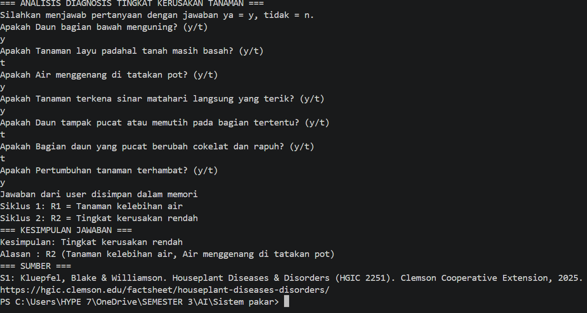
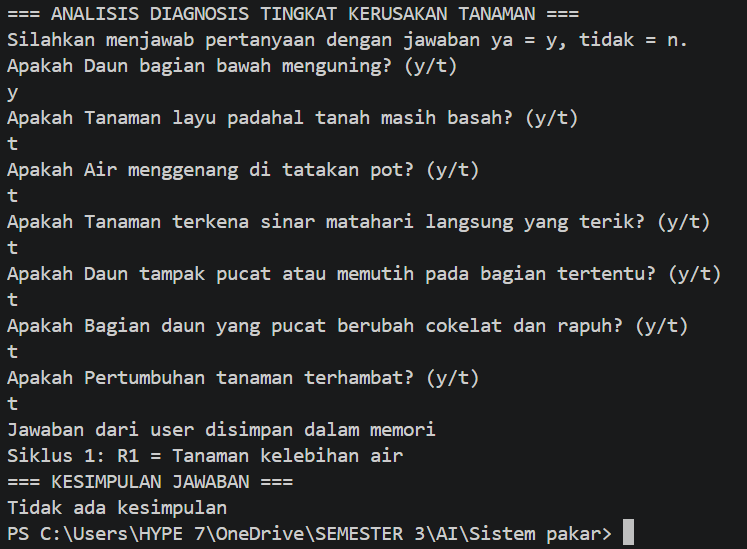

# Sistem Pakar: Analisis Tingkat Kerusakan Tanaman Hias (Forward Chaining)

Program sederhana berbahasa Java yang menyimpulkan tingkat kerusakan tanaman hias
(rendah/sedang/tinggi) dengan metode **forward chaining**. Program memakai
**fakta** (gejala pada tanaman) dari user lalu menarik **kesimpulan**, lengkap
dengan alasan dan sumber referensinya.

## Struktur Program

| File | Isi |
|---|---|
| `SistemPakarTanaman.java` | Program utama: membaca aturan dan sumber dari file, bertanya ke user, algoritma FC, kesimpulan, alasan, dan sumber |
| `Aturan.java` | Class penyimpan satu aturan IF-THEN: `id`, syarat (`jika`), `mode`, hasil (`maka`) |
| `AturanFile.txt` | Basis pengetahuan, dibagi dua blok kurung kurawal: `{aturan ...}` berisi 5 aturan berformat `id\|mode\|syarat\|hasil\|kode sumber`, dan `{sumber ...}` berisi keterangan sumber berformat `kode\|keterangan` |

## Cara Menjalankan

```bat
javac -encoding UTF-8 SistemPakarTanaman.java Aturan.java
java SistemPakarTanaman
```

Program menanyakan 7 pertanyaan tentang kondisi tanaman. Jawab dengan `y` (ya) atau `t` (tidak).

## Basis Pengetahuan: 5 Aturan IF-THEN

| Aturan | Jika | Mode | Maka | Sumber |
|---|---|---|---|---|
| R1 | daun bagian bawah menguning, tanaman layu padahal tanah masih basah | atau | Tanaman kelebihan air | S1 |
| R2 | tanaman kelebihan air, air menggenang di tatakan pot | dan | Tingkat kerusakan rendah | S1 |
| R3 | tanaman terkena sinar matahari langsung yang terik, daun tampak pucat atau memutih pada bagian tertentu | dan | Daun terbakar sinar matahari | S2 |
| R4 | daun terbakar sinar matahari, bagian daun yang pucat berubah cokelat dan rapuh | atau | Tingkat kerusakan sedang | S2 |
| R5 | tingkat kerusakan sedang, pertumbuhan tanaman terhambat | dan | Tingkat kerusakan tinggi | S3 |

Mode `dan` = semua syarat harus ada di memori. Mode `atau` = cukup salah satu.

Ada 5 kesimpulan: 2 kesimpulan antara (tanaman kelebihan air, daun terbakar
sinar matahari) dan 3 kesimpulan akhir (tingkat kerusakan rendah, sedang,
tinggi). Hasil satu aturan dipakai sebagai syarat aturan lain (R2 memakai hasil
R1, R4 memakai hasil R3, R5 memakai hasil R4). Itulah rantai (chaining) pada
forward chaining.

## Sumber

| Kode | Sumber |
|---|---|
| S1 | Kluepfel, M., Blake, J. H., & Williamson, J. *Houseplant Diseases & Disorders* (HGIC 2251). Clemson Cooperative Extension, diperbarui 28 Feb 2025. https://hgic.clemson.edu/factsheet/houseplant-diseases-disorders/ (diakses 13 Nov 2026) |
| S2 | Davison, E. (1998). *Indoor Plant Selection and Care* (AZ1025). University of Arizona Cooperative Extension. https://extension.arizona.edu/publication/indoor-plant-selection-and-care (diakses 13 Nov 2026) |
| S3 | Pettinelli, D. *Fertilizing Houseplants Fact Sheet*. UConn Extension, 2020. https://soiltesting.cahnr.uconn.edu/wp-content/uploads/sites/3514/2023/03/Fertilizing-Houseplants-Fact-Sheet.pdf (diakses 13 Nov 2026) |

Pembagian tingkat rendah/sedang/tinggi adalah rancangan aturan penulis. Sumber
hanya mendukung gejala pada tiap aturan.

## Cara Kerja Program

1. **Membaca file.** Program membaca `AturanFile.txt`. Isi blok `{aturan}`
   disimpan sebagai daftar aturan, isi blok `{sumber}` disimpan sebagai
   keterangan sumber. Baris kosong dan baris berawalan `#` dilewati.
2. **Fakta awal.** Program menanyakan 7 gejala tanaman. Setiap jawaban `y`
   disimpan ke `memori`.
3. **Penalaran.** Program mengulang selama ada perubahan. Aturan yang hasilnya
   sudah ada di memori dilewati. Kalau syarat terpenuhi, hasilnya ditambahkan
   ke memori sebagai fakta baru dan alasannya dicatat.
4. **Berhenti** saat satu putaran penuh tidak menambah fakta baru.
5. **Kesimpulan akhir** = fakta terakhir di memori yang mengandung kata
   "tingkat kerusakan", lengkap dengan alasannya.
6. **Sumber.** Di bagian paling bawah output, program mencetak keterangan
   sumber (dari blok `{sumber}`) milik aturan-aturan yang terpakai.

## Contoh Kasus Uji 1

Jawaban "y": daun bagian bawah menguning, air menggenang di tatakan pot.

```
Siklus 1: R1 = Tanaman kelebihan air
Siklus 2: R2 = Tingkat kerusakan rendah
=== KESIMPULAN JAWABAN ===
Kesimpulan: Tingkat kerusakan rendah
Alasan : R2 (Tanaman kelebihan air, Air menggenang di tatakan pot)
=== SUMBER ===
S1: Kluepfel, Blake & Williamson. Houseplant Diseases & Disorders (HGIC 2251). Clemson Cooperative Extension, 2025. https://hgic.clemson.edu/factsheet/houseplant-diseases-disorders/
```

## Kasus Uji

| # | Jawaban "y" | Kesimpulan yang diharapkan |
|---|---|---|
| 1 | daun bagian bawah menguning, air menggenang di tatakan pot | Tingkat kerusakan rendah |
| 2 | terkena sinar matahari langsung yang terik, daun tampak pucat atau memutih | Tingkat kerusakan sedang |
| 3 | semua 7 pertanyaan dijawab y | Tingkat kerusakan tinggi |
| 4 | semua dijawab t | Tidak ada kesimpulan |

## Tampilan Program

| Ada Kesimpulan | Tidak Ada Kesimpulan |
|---|---|
|  |  |
